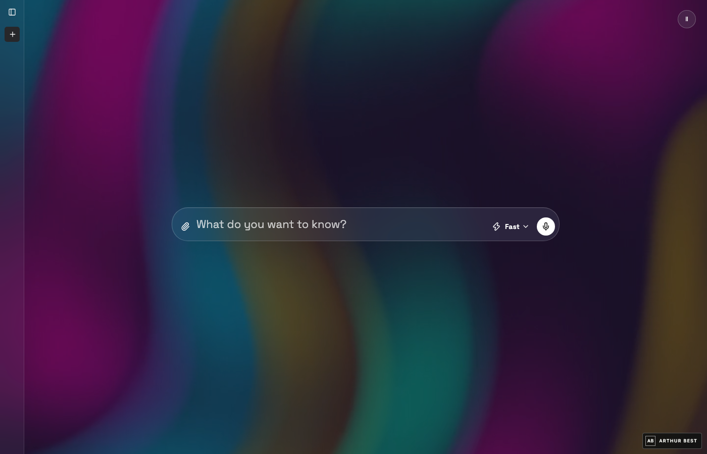

# hoffLyn Chat - Motion

A motion-themed AI chat app built with Next.js, assistant-ui, and immersive video backgrounds.



## Features

- Multiple chat layouts (Base, Claude, Gemini, hoffLyn, Perplexity)
- Immersive motion video backgrounds (city, desert, forest, Pexels abstracts, etc.)
- Arthur Best credit fixed at bottom-right
- Markdown, attachments, model picker, and more

## Getting Started

```bash
npm install
npm run dev
```

Open http://localhost:3000

## Background Sources

Free motion/abstract background videos:

- Pixabay — https://pixabay.com/videos/search/background/
- Pexels — https://www.pexels.com/search/videos/abstract/
- Mixkit — https://mixkit.co/free-stock-video/abstract/

Download clips as `.mp4`, drop them into `public/motion/`, and add the filename to `components/motion-shell.tsx`.

## Deploy to GitHub Pages

Build static export:

```bash
npm run build
```

The static site is in `out/`. Push `out/` to your GitHub Pages branch.

## Component Library Reference (Aura.build)

| Component | Link |
|-----------|------|
| Hero | https://www.aura.build/components?componentType=free&q=Hero |
| Store | https://www.aura.build/browse/components?q=store&page=1 |
| Code | https://www.aura.build/components?componentType=free&q=code |
| Section | https://www.aura.build/components?componentType=free&q=Section |
| Button | https://www.aura.build/components?componentType=free&q=Button |
| Card | https://www.aura.build/components?componentType=free&q=Card |
| Background | https://www.aura.build/components?componentType=free&q=Background |
| Header | https://www.aura.build/components?componentType=free&q=Header |
| Logo | https://www.aura.build/components?componentType=free&q=Logo |
| Feature | https://www.aura.build/components?componentType=free&q=Feature |
| Pricing | https://www.aura.build/components?componentType=free&q=Pricing |
| Testimonial | https://www.aura.build/components?componentType=free&q=Testimony |
| Footer | https://www.aura.build/components?componentType=free&q=Footer |
| Form | https://www.aura.build/components?componentType=free&q=Form |
| Heading | https://www.aura.build/components?componentType=free&q=Heading |
